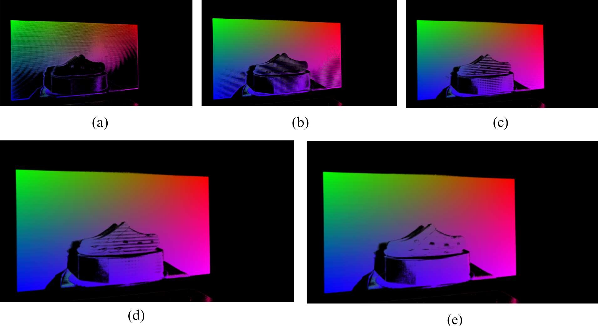
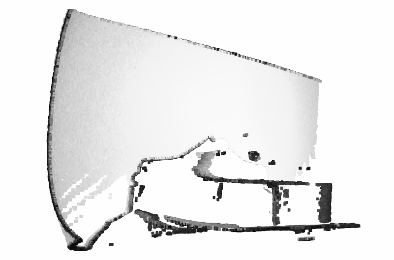
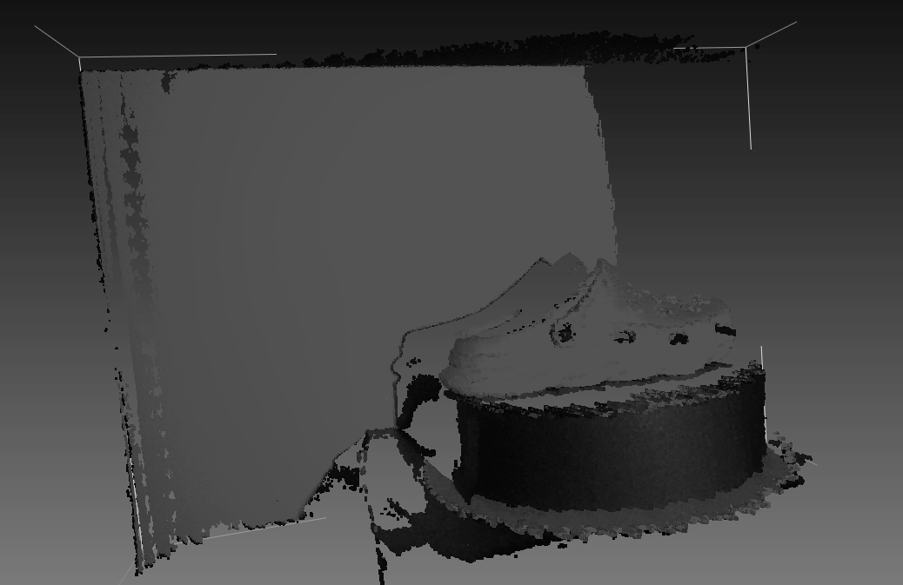

# REOSSI

**REOSSI - Resolution Enhancement by Overlapping of Shifted and Scaled Identifiers** - is a structured-light method developed by Rolando Cortez to increase the density of decoded identifiers for 3D reconstruction. Structured-light systems face resolution limits and decoding errors caused by light leakage, noise and surface discontinuities. REOSSI addresses these challenges by projecting wider patterns, generating digitally shifted pattern sets, and scaling and overlapping their decoded identifier matrices.

The associated research reports higher point-cloud resolution and more robust decoding with standard, low-cost hardware. Processing time remains a limitation, with improved projector–camera synchronization identified as an avenue for reducing it.

This repository provides a modular implementation of the scanning pipeline: camera/projector calibration, pattern acquisition, Gray-code decoding, REOSSI identifier reconstruction, and point-cloud export. Physical captures and digital scenes share the same decoding and reconstruction core, while direct identifier experiments provide a separate entry point for studying the method.




*Decoded identifiers: (a) conventional method; (b) 960×540; (c) 640×360; (d) 480×270; (e) 320×180 emulated resolution. The panels show decoding before the final identifier scaling and fusion.*

With the low-cost projector, limited contrast and uneven focus made fine projected fringes difficult to distinguish. Conventional decoding left large gaps in the reconstructed scene. REOSSI uses wider patterns and shifted, scaled identifier layers to recover a more complete point cloud.

<table>
  <tr>
    <th>Conventional structured light</th>
    <th>REOSSI · 320×180 emulated resolution</th>
  </tr>
  <tr>
    <td width="50%"></td>
    <td width="50%"></td>
  </tr>
</table>

*Point-cloud examples, converted to grayscale. Viewpoints and rendering settings differ between screenshots.*

The physical prototype paired an HY300 projector in the approximately US$50 price range with a OAK-1 camera. REOSSI aims to lower the hardware cost barrier to structured-light 3D reconstruction by improving decoding and combining shifted, scaled identifier layers. Its broader goal is to improve decoded coverage and point-cloud quality across projector–camera systems, from inexpensive setups to more capable hardware.


## Installation

Use Python 3.10–3.12:

```bash
python3.12 -m venv .venv
source .venv/bin/activate
python -m pip install -e '.[dev,mesh,plots]'
reossi --help
```

`mesh` adds standard mesh-file loading; `plots` adds scientific visualization. Neither is needed for the small generated scenes. The optional `oak` extra installs the historical DepthAI adapter. NumPy and OpenCV versions are pinned for numerical continuity.

## Try a digital scan

A small rectangular diagnostic opens no windows or devices:

```bash
reossi simulate --config configs/synthetic.json --output outputs/raster
```

Project actual Gray patterns onto a known triangle mesh, save virtual captures, and reconstruct a cloud:

```bash
reossi simulate-scene --config configs/synthetic_3d.json \
  --scene-config configs/scene_curved.json \
  --output outputs/curved --save-captures

reossi reconstruct --input outputs/curved \
  --calibration outputs/curved/calibration.npz \
  --identifier-origin one --output outputs/curved-cloud
```

The scan includes raw identifier maps, independent surface/correspondence truth, known calibration and sensor settings. Reconstruction saves PLY plus aligned numerical points, colors and camera pixels. Supply `--mesh object.ply` to replace the generated surface; OBJ/STL/PLY mesh loading needs the `mesh` extra. A point-only cloud must first be given a surface representation.

View saved results interactively, or export a figure with `--no-show`:

```bash
reossi view --input outputs/curved-cloud
reossi view-identifiers --input outputs/curved
reossi simulate-identifiers --config configs/identifier_demo.json --output outputs/identifier-demo
```

The direct identifier demonstration bypasses image formation and decoding. It exposes shifted and scaled layers for fast method-level study.

The initial 3D renderer models pinhole geometry, visibility and direct illumination with optional intensity noise. It does not model global light transport or validate physical scanner accuracy. See [simulation](docs/simulation.md).

Compare conventional, LD and REOSSI processing on one small, known 3D plane:

```bash
python examples/compare_modes.py --output outputs/mode-comparison --plot
```

The example uses native-pixel pattern displacements, explicit identifier origins and the same virtual rig for all three modes. It saves point clouds, identifier maps and comparison metrics. See [the comparison walkthrough](docs/comparison.md) for its assumptions and the preserved source-placement option.

## Physical scanner workflow

Edit [configs/calibration.json](configs/calibration.json) to match the actual board, image sizes, camera and projector. Measure printed square/marker dimensions and keep frame orientation consistent during calibration and scanning.

```bash
reossi board --config configs/calibration.json --output outputs/board.png

reossi collect-camera-calibration --config configs/calibration.json \
  --output data/camera-observations
reossi calibrate-camera --config configs/calibration.json \
  --input data/camera-observations --output outputs/camera.npz

reossi collect-projector-calibration --config configs/calibration.json \
  --camera-calibration outputs/camera.npz --output data/projector-observations
reossi calibrate-projector --config configs/calibration.json \
  --camera-calibration outputs/camera.npz \
  --input data/projector-observations --output outputs/stereo.npz

reossi capture --config configs/scan_real.json --output recordings/object
reossi reconstruct --input recordings/object --calibration outputs/stereo.npz \
  --identifier-origin one --output outputs/object-cloud
```

Calibration can also use existing images, without running either collection command. Camera/projector capture commands operate hardware only when explicitly invoked. See [calibration](docs/calibration.md) for board setup, controls, diagnostics and solver conventions.

## Configuration and replay

```bash
reossi plan --config configs/reossi_320.json
reossi patterns --config configs/synthetic.json --output outputs/patterns
reossi replay --config configs/reossi_320.json \
  --input recordings/object --output outputs/replayed --layout runs
```

Configuration separates native projector size, emulated pattern size, optional intermediate target, repetitions and classification thresholds. Hardware settings belong to an `acquisition` object. See [configuration](docs/configuration.md).

Recording files contain grayscale `images` arrays shaped `(frames, height, width)`. The `runs` layout uses zero-based `run_R_displacement_D.npz` filenames. The `single` layout uses `displacement_D.npz` and requires an explicit `repeats=1`; missing runs are never invented. Replay preserves the input dtype and copies an available `white.png` reference.

Outputs are protected against accidental replacement. Choose a new output path for each run. `--max-sequence-mib` bounds one stack, not total process memory; decoding requires additional temporary arrays. Small examples are the recommended first check.

## Structure and development

```text
src/reossi/
  acquisition/       camera adapters, capture and recording IO
  calibration/       boards, solvers and observation workflows
  structured_light/  Gray patterns, illumination and bit decoding
  reconstruction/    identifier operations, geometry and export
  simulation/        digital raster and triangle-scene inputs
  cli/               thin workflow commands
configs/             method, hardware and scene parameters
tests/               autonomous numerical and integration checks
docs/                usage, contracts and validation limits
```

```bash
OMP_NUM_THREADS=1 OPENBLAS_NUM_THREADS=1 python -m pytest -q
ruff check src tests
ruff format --check src tests
```

Tests use analytical correspondences, small generated inputs and mocked acquisition; they do not require the old project or a device. The software integration, physical acquisition and photometric realism have separate validation statuses. See [development notes](docs/development-notes.md) and the [technical roadmap](ROADMAP.md).

The [method block map](docs/method.md) identifies REOSSI operations and their shared scanner foundation. For direct use from experiments, see the [Python API and extension boundaries](docs/python-api.md).

The initial numerical profiles preserve the recovered implementation. See [architecture and numerical conventions](docs/architecture.md) for their coordinate conventions and compatibility limits.

## Acknowledgments and licensing

Selected structured-light scanning components are adapted from [Guillaume Charron's 3DScanner-GrayCode](https://github.com/guillaume-charron/3DScanner-GrayCode). Their provenance and applicable notices are documented in [THIRD_PARTY_NOTICES.md](THIRD_PARTY_NOTICES.md), with the inherited MIT terms retained in [LICENSES/Charron-MIT.txt](LICENSES/Charron-MIT.txt).

Original REOSSI contributions are licensed under [PolyForm Noncommercial 1.0.0](LICENSE), with the required copyright notice in [NOTICE](NOTICE). Uses outside its permitted purposes require a separate agreement with Rolando Cortez Garcia. The adapted third-party portions retain their MIT permissions; this does not make the original REOSSI contributions MIT-licensed. See [licensing and contribution boundaries](docs/licensing.md) for the original operations, mixed files and commercial-use scope.
