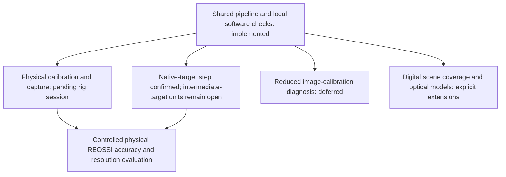

# Technical roadmap

This roadmap records the project scope and validation gates. It is not a claim that a physical scanner or realistic optical renderer has already been validated.

| Area | Implemented scope | Remaining gate |
| --- | --- | --- |
| Package structure | Maintained acquisition, calibration, structured-light, reconstruction, simulation and CLI modules; local wheel/source installation checks | Maintain installation and distribution checks as the code changes |
| Source continuity | Preserved conventional/LD/REOSSI profiles; Chapter 8's native-target step confirmed; opt-in native-pixel export/capture/simulation; [adversarial review](docs/chapter-8-review.md) | Resolve intermediate-target spatial/identifier units and historical producer identity before changing that path |
| Camera calibration | Board generation, observation collection, image-based solver, diagnostics and saved parameters | Validate the actual printed board, capture geometry and device behavior |
| Projector/stereo calibration | Grid generation, observation collection, explicit solver criteria, intrinsic reuse and R/T output | Validate physical projector timing, coverage and reprojection geometry |
| Capture/replay | Complete recording, partial-run metadata, explicit dtype, shared decoding and opt-in native-pixel placement matching export/simulation | Hardware frame association, physical step verification and full-resolution resource measurement |
| Reconstruction | Explicit identifier origin/frame/filter choices, aligned masks/points/colors and PLY export | Representative physical reconstruction accuracy |
| Digital raster | Seeded frame-level diagnostic and known identifier coordinates | Extend only when a new hypothesis requires it |
| Triangle scenes | Camera/projector geometry, direct rendering, visibility, truth, replay, mesh round trips and a shared-rig three-mode comparison | Broader scenes and independently checked geometric cases |
| Identifier experiments | Direct entry at the map transformation/fusion boundary | Keep logical map models distinct from optical rendering |
| Optical fidelity | Direct-only scalar response is explicit | Decide blur/material/global-transport models and validate them separately |
| Quality | Autonomous tests, formatting, lint, local installation checks and passing GitHub Actions checks on Python 3.10–3.12 | Maintain CI checks and explicit validation scope as the project evolves |

## Validation dependencies

Physical Charron-style calibration can be evaluated with its own observations and quality checks while the reduced digital-calibration diagnosis remains open. Resolving identifier displacement units is a prerequisite for attributing a physical resolution improvement to REOSSI, not for collecting camera-calibration images. The diagram records dependencies, not authorization to start another experiment or operate a device.

## Completion criteria

1. Installation, tests and supported commands work without the original project or copied reference implementations.
2. Camera calibration, projector/stereo calibration, capture/replay and reconstruction exchange documented files directly.
3. Numerical changes are explicit and evaluated separately from structural refactoring.
4. Final source contains maintained functionality, meaningful examples and tests, with required attribution/licenses; no backups or discarded versioned scripts.
5. Generated data, captures, outputs and optional visualization remain separate from source.
6. Physical operation, numerical correctness, geometric simulation and photometric realism have separate evidence and limits.

## Resource policy

Start with small arrays and low-resolution scenes. Estimate captures and temporary memory before large work. Use one shared host-resource check at meaningful checkpoints, avoiding persistent per-worker monitors and overlapping heavy workloads. Per-stack limits do not bound total process memory. Stop additional heavy work if sustained resource pressure appears; preserve progress without changing host configuration or unrelated processes.
