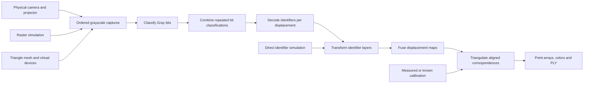

# Architecture and numerical conventions

REOSSI separates generation of input data from the shared structured-light processing and reconstruction. A physical camera and a virtual camera produce the same ordered grayscale capture arrays. Identifier-level experiments may enter after decoding, while image-level simulations traverse the actual classifier.



## Responsibilities

| Module | Responsibility |
| --- | --- |
| `plan.py` | Validated native/emulated/target resolutions and source-compatible factors |
| `acquisition/` | Explicit camera construction, projection/capture, NPZ recording and replay |
| `calibration/` | Physical boards, camera/projector solvers, observation acquisition and self-describing calibration files |
| `structured_light/` | Gray words, raster patterns, basic direct/global estimation, bit classification and decoding |
| `reconstruction/` | REOSSI identifier transformation/fusion, stereo geometry and aligned point-cloud export |
| `simulation/` | Fast digital captures, triangular surfaces, camera/projector visibility and known ground truth |
| `pipeline.py` | Compose repeated capture decoding and displacement reconstruction |
| `cli/` | Thin commands connecting configuration, APIs and saved outputs |

No hardware opens at import time. Optional visualization, mesh loading and OAK dependencies are loaded only by their relevant operations. Generated captures and outputs belong outside `src/`.

## Shared data contracts

- Sizes are `(width,height)`; images are indexed `[row,column]`.
- Captures are grayscale `(frames,height,width)` arrays. Source frame order is black, white, interleaved column/row patterns, then their inverses.
- Classified bits are `(bits,height,width)` int8 arrays; unknown bits are -1.
- Identifier maps are `(height,width)` arrays with explicit zero/one-based conventions.
- Repetitions are aggregated as bits before integer decoding. Transformed displacement maps are fused afterward. Those operations have different meanings.
- Calibration saves intrinsics, distortion, image sizes, camera-to-projector R/T, units and diagnostics together. Physical calibration is estimated; virtual calibration is known from device poses.
- Reconstruction saves aligned points, RGB colors, camera/projector coordinates and the retained camera-pixel mask. Filtering applies to every aligned array.

The decoder accepts an optional `illumination_estimator(images)` callable returning grayscale direct/global arrays `(height,width)`. This is an ordinary function boundary: alternate estimators own their parameters and must explicitly handle any color-to-gray policy. Default processing remains self-contained.

## Preserved REOSSI behavior

Conventional mode uses Charron's zero-based generator and zero normalization epsilon. LD/REOSSI use the recovered one-based generator and 1e-5 epsilon unless explicitly overridden. The in-place identifier transform is:

```text
F * (identifier - 1) + step * displacement + 1
```

Exactly -1 is preserved; zero and other negative values follow the formula. Final column layers retain the source stack/reduction axis 1 and row layers axis 0. Both produce a per-pixel maximum.

The low-level `scale_identifiers` API makes alternative sentinel policies explicit through `invalid_values`: the default `(-1,)` preserves the scanner convention; `()` transforms every value; `(-1,0)` preserves both sentinels. Changing this parameter changes numerical results and requires a matching validity policy. The scan pipeline always retains its default convention.

The classifier retains its assignment order, including later rules that can overwrite a low-direct-illumination assignment. Stored uint8 and live float64 inputs can have different arithmetic; replay does not silently promote arrays.

The geometry primitive retains the reference sine-rule calculation, correspondence order, edge clipping and in-place projector-intrinsic scaling. The workflow copies calibration arrays, exports explicit coordinate frames and allows explicit one-based-to-zero-based conversion. The default `legacy` identifier interpretation retains direct source-coordinate use; `one` subtracts one before geometric reconstruction.

## Source semantics requiring further validation

The recovered generator rolls whole emulated identifier cells before rendering. The default `emulated_cells` placement retains that behavior. The explicit `native_pixels` placement instead shifts an enlarged raster by native pixels, as specified for the Chapter 8 experiment with native target resolution. Export, physical capture and triangle simulation share this choice. Simulation compares both against independently generated geometric truth; expected coordinates are not adjusted to match decoded results. See the [comparison walkthrough](comparison.md).

One-based identifiers through a power-of-two maximum exceed the retained Gray bit count at the final identifier. The historical truncated result remains visible. Resolution factors use integer-truncated maximum-dimension ratios; nonproportional dimensions are not a validated physical generalization.

The intermediate target path retains the historical second scaling. Native 1920×1080, target 960×540 and emulated 480×270 compose to `4*(m-1)+4*d+1`; the displacement units require review before physical resolution claims.

The historical local camera calibration used inconsistent physical board lengths in detection and solving. The new workflow requires a single explicit board definition, with the upstream board as its default. Existing calibration cannot be certified from a directory name.

Maintained tests are autonomous: analytic Gray words, known geometry, seeded digital inputs and mocked IO. Historical migration comparisons were performed outside the final package. No copied reference implementation or runtime dependence on the old project ships here.
